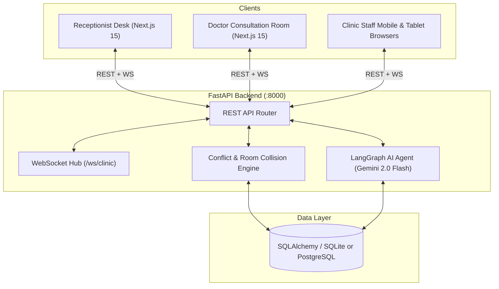
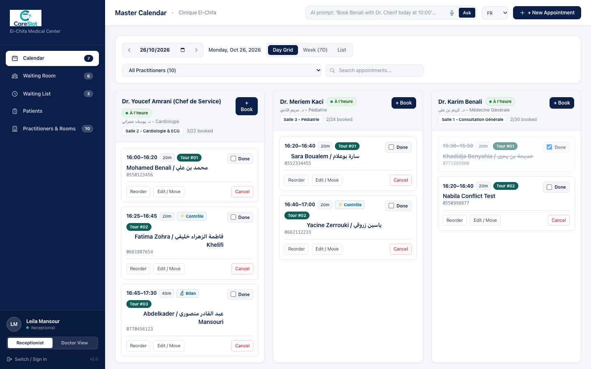
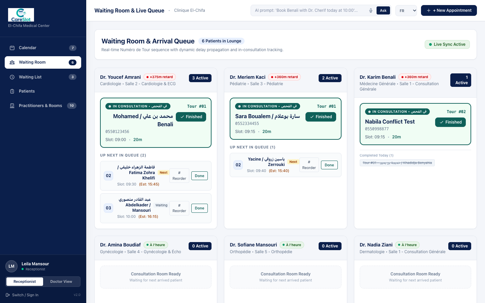
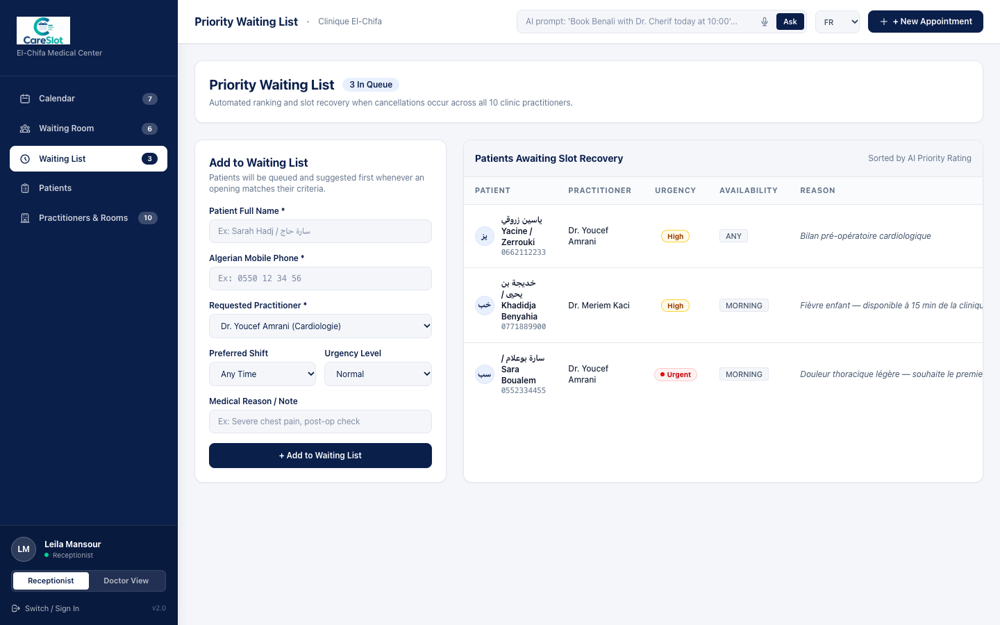
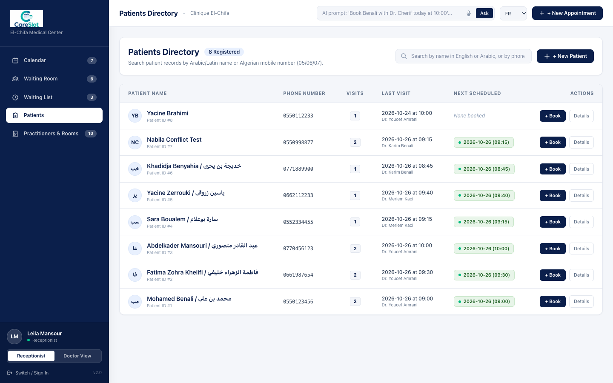
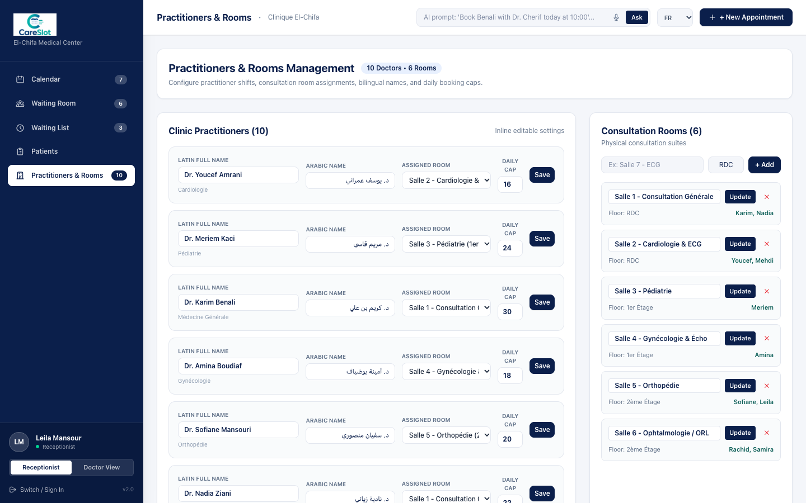
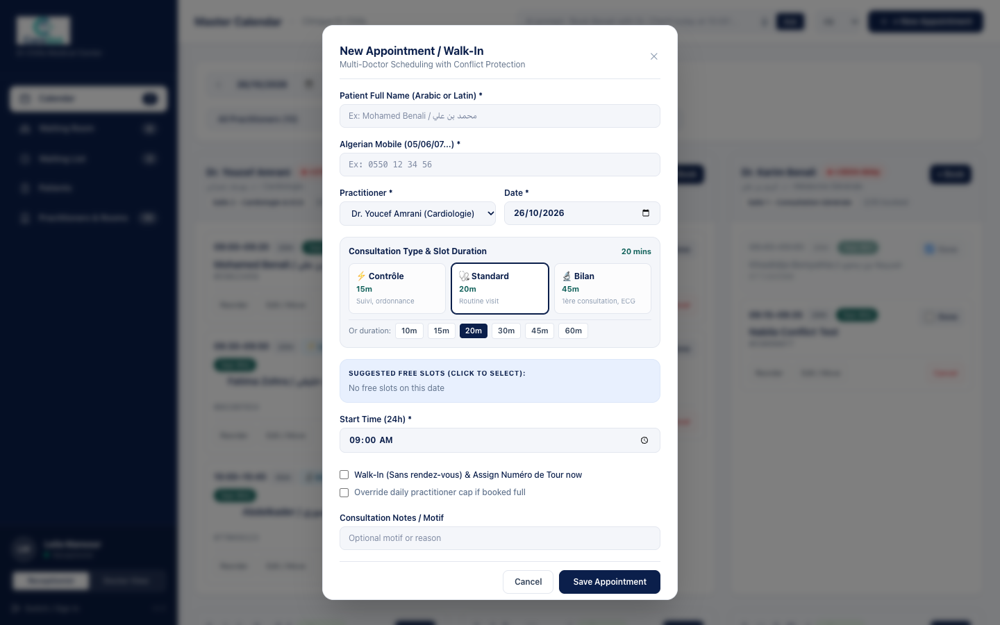
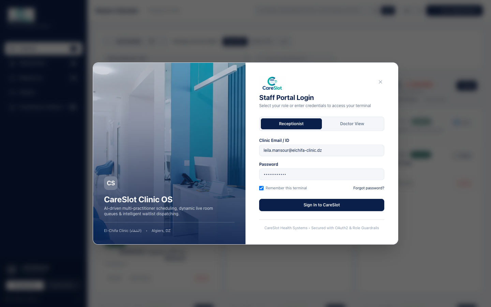
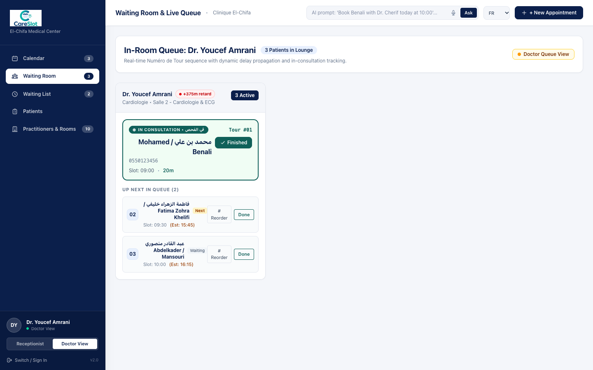

# CareSlot

> **AI-Powered Multi-Practitioner Clinic Scheduling & Real-Time Queue Management System**

CareSlot is an intelligent clinic management platform designed to replace manual paper agendas (*cahiers de rendez-vous*) with centralized multi-practitioner scheduling, live patient arrival numbering (*Numéro de Tour / رقم الدور*), collision-free consultation room management, and a human-in-the-loop AI voice/text booking assistant powered by **LangGraph** and **Google Gemini 2.0 Flash**.

---

## Key Features

- **Multi-Practitioner Master Calendar**:
  - Live side-by-side doctor columns and 7-day week scheduling views.
  - Real-time practitioner delay tracking (On-Time, Moderate, Heavy delay indicators).
  - Flexible consultation durations per doctor (10m, 15m, 20m, 30m, 45m, 60m).

- **Live Waiting Room Queue & Arrival Numbering**:
  - Automatic sequential arrival numbering (*Numéro de Tour / رقم الدور*) upon patient check-in.
  - Manual drag/reorder capability for emergency priority shifts.
  - 1-click consultation completion toggle with immediate queue filtering.

- **4-Dimensional Conflict & Collision Engine**:
  - Validates practitioner working hours and Algerian weekend observance (Friday off).
  - Prevents doctor time-slot double bookings.
  - Detects physical consultation room collisions across different doctors sharing the same room.
  - Enforces daily patient appointment caps per practitioner with override guards.

- **Human-in-the-Loop AI Booking Assistant (LangGraph + Gemini 2.0 Flash)**:
  - Natural language scheduling via text or voice in French, Arabic, Algerian Darja, or English.
  - Extracts patient details, doctor preference, date, and time slot.
  - Suggests optimal collision-free slots clustering appointments cleanly.
  - Stages proposed actions for receptionist confirmation before committing to the database.
  - Built-in deterministic regex fallback when offline or LLM API is unavailable.

- **Intelligent Waiting List & Cancellation Recovery**:
  - Manages active waiting lists per doctor with preferred shift and urgency scoring.
  - When an appointment is cancelled, instantly broadcasts real-time alerts and ranks eligible waitlist candidates to fill the freed slot.

- **Role-Based Workspaces**:
  - **Receptionist Mode**: Comprehensive view of all 10 practitioners, appointment booking, arrival assignments, and clinic settings.
  - **Doctor Mode**: Focused consultation room view showing the doctor's daily patient queue, consultation status, and quick finishes.

- **Real-Time WebSocket Synchronization**:
  - Instant bi-directional updates across all reception desks and doctor rooms via WebSockets (`/ws/clinic`).

---

## Tech Stack

| Layer | Technology |
|---|---|
| **Frontend** | [Next.js 15](https://nextjs.org/) (App Router), React 19, TypeScript, Tailwind CSS v4 |
| **Backend API** | [FastAPI](https://fastapi.tiangolo.com/), Python 3.11+, WebSockets, Pydantic v2 |
| **Database** | SQLAlchemy 2.0 ORM, SQLite (local development) / PostgreSQL (production ready) |
| **AI Orchestration** | [LangGraph](https://github.com/langchain-ai/langgraph), [LangChain](https://github.com/langchain-ai/langchain), Google Gemini 2.0 Flash |

---

## Architecture Overview



---

## Getting Started

### Prerequisites
- **Python 3.11+**
- **Node.js 18+** and **npm**
- *(Optional)* [Google AI Studio API Key](https://aistudio.google.com/) for Gemini 2.0 Flash LLM integration (the system includes an automatic offline fallback if no key is provided).

---

### 1. Backend Setup

1. Navigate to the backend directory:
   ```bash
   cd backend
   ```

2. Create and activate a Python virtual environment:
   ```bash
   python3 -m venv .venv
   source .venv/bin/activate      # On Windows: .venv\Scripts\activate
   ```

3. Install dependencies:
   ```bash
   pip install -r requirements.txt
   ```

4. Configure environment variables:
   ```bash
   cp .env.example .env
   ```
   *(Optionally add your `GOOGLE_API_KEY` in `backend/.env`)*

5. Start the backend server:
   ```bash
   uvicorn main:app --reload --port 8000
   ```
   The backend will start at `http://127.0.0.1:8000`. It will automatically seed initial clinic data (10 practitioners, 6 consultation rooms, sample bilingual patients, and appointments) on first launch.

---

### 2. Frontend Setup

1. In a new terminal window, navigate to the frontend directory:
   ```bash
   cd frontend
   ```

2. Install dependencies:
   ```bash
   npm install
   ```

3. Start the Next.js development server:
   ```bash
   npm run dev
   ```

4. Open `http://localhost:3000` in your browser.

---

## Running the Automated Test Suite

CareSlot includes a comprehensive automated test script verifying all core clinic workflows (calendar overview, appointment lifecycle, conflict detection, room collisions, arrival queue ordering, cancellation waitlist matching, and AI agent endpoints):

```bash
# With the backend running on port 8000:
python backend/test_api.py
```

Expected output:
```text
============================================================
CareSlot Comprehensive Production Workflow Verification
============================================================
[PASS] UC-01: Calendar Overview & 10 Doctors
[PASS] UC-02: Search Multilingual Patient
[PASS] UC-03: Create Appointment & Dynamic Duration
[PASS] UC-04: Conflict & Room Collision Check
[PASS] UC-05: Patient Arrival & Sequential Numbering
[PASS] UC-06: Manual Reorder Arrival Number
[PASS] UC-07: Finish Consultation & Queue Filtering
[PASS] UC-08: Add to Waiting List
[PASS] UC-09: Cancel Appointment & Waitlist Alert
[PASS] UC-10: Update Practitioner Details
[PASS] UC-11: Room Management (Create, Rename, Delete)
[PASS] UC-12: AI Slot Suggestions
[PASS] UC-13: LangGraph AI Chat & Booking
[PASS] UC-14: LangGraph AI Confirmation Gate
============================================================
ALL 14 PRODUCTION WORKFLOWS PASSED (100% SUCCESS)
============================================================
```

---

## Screenshots & User Interface

| Master Calendar | Live Waiting Room Queue |
| :---: | :---: |
|  |  |

| Priority Waiting List | Patients Directory |
| :---: | :---: |
|  |  |

| Practitioners & Rooms | Flexible Booking Modal |
| :---: | :---: |
|  |  |

| Staff Login Portal | Doctor Mode View |
| :---: | :---: |
|  |  |
